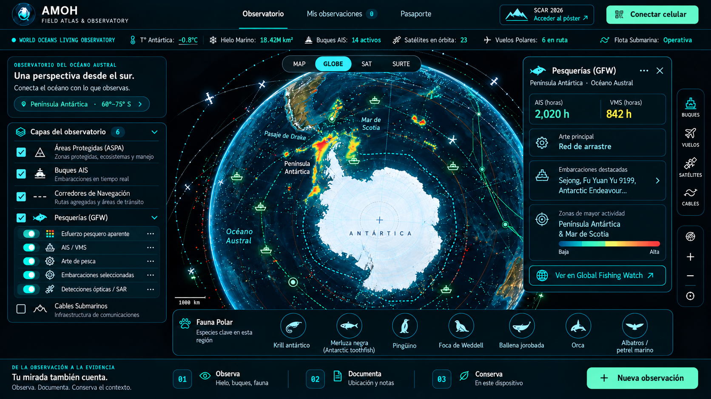

# Antarctic Maritime Observation Hub

**OLEA** es un observatorio geoespacial experimental para la Antártida y el Océano Austral. Reúne capas científicas, tráfico marítimo, expediciones y observaciones de campo en un mapa y globo interactivos.

[Observatorio OLEA](https://juanshuertas.github.io/antarctic-maritime-observation-hub/olea/) · [PB124](https://juanshuertas.github.io/antarctic-maritime-observation-hub/peaceboat/) · [Demostración](Antarctic_Maritime_Hub_compressed.mp4) · [Póster SCAR 2026](https://virtual.oxfordabstracts.com/event/75327/poster-gallery/grid?sort=titles&current=1820)



## Empieza aquí

| Ruta | Qué contiene |
| --- | --- |
| [`app/`](app/) | Frontend editable en React, Vite y TypeScript. Incluye builds separados para OLEA y PB124. |
| [`backend/`](backend/) | Servicio público FastAPI con DuckDB, salud y endpoints AIS. |
| [`ecsan-ddhh-dih-toolkit`](https://github.com/juanshuertas/ecsan-ddhh-dih-toolkit) | Microclase ECSAN, con su propio proyecto frontend. |
| [`pb124-pages`](https://github.com/juanshuertas/antarctic-maritime-observation-hub/tree/pb124-pages) | Sitio compilado que publica GitHub Pages. OLEA vive en `/olea/`, y PB124 en la raíz y en `/peaceboat/`. |

## Desarrollo local

Para el frontend necesitas Node.js 24, Git y tar. Desde un clon del repositorio:

```sh
git fetch origin pb124-pages
cd app
npm ci
npm run assets:public
npm run dev
```

Abre [OLEA local](http://localhost:5174/). La importación recupera recursos de una revisión pública de Pages. Las capas que requieren productos adicionales o servicios externos dependen de su configuración. [Guía del frontend](app/README.md)

Para iniciar el backend público desde la raíz, ejecuta `docker compose up --build backend`. Comprueba [el estado del servicio](http://localhost:8000/health) y consulta [las rutas OpenAPI](http://localhost:8000/docs). El backend de este repositorio cubre parte de las funciones del Observatorio. Las funciones de campo e integraciones adicionales requieren sus servicios y datos correspondientes.

## Verificación y despliegue

En `app/`, ejecuta `npm run typecheck` para revisar TypeScript y `npm run build` para generar `dist/`. GitHub Actions verifica en cada cambio relevante el frontend y sus variantes para Pages y PB124. El código se edita en `main`. La publicación de Pages usa los archivos de `pb124-pages`. [Instrucciones para construir y desplegar](app/README.md#github-pages) · [Verificaciones en GitHub](https://github.com/juanshuertas/antarctic-maritime-observation-hub/actions/workflows/olea-ci.yml)

Mantén las credenciales y las configuraciones de operación en el entorno privado. Comparte capas, imágenes y observaciones conforme a sus permisos de redistribución.

## Investigación y licencia

AMOH es un prototipo de investigación iniciado por Juan Sebastian Huertas Olea. El código del repositorio usa la [licencia MIT](LICENSE). Los datos y recursos de terceros conservan sus licencias de origen. [Descripción científica, arquitectura y hoja de ruta](docs/project-overview.md)
