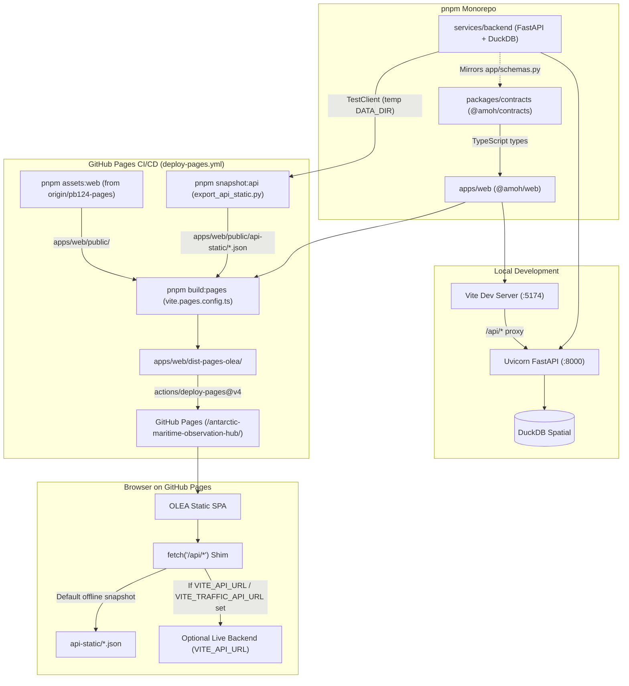
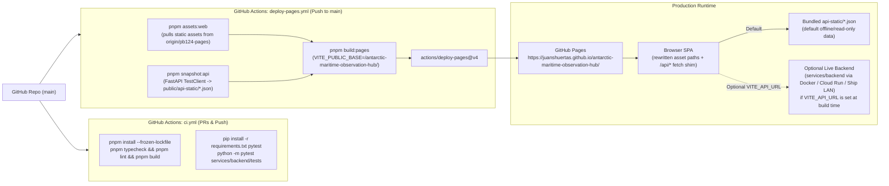

# AMOH Monorepo Architecture & Deployment Guide

This repository is organized as a `pnpm` workspace monorepo combining the OLEA / AMOH Polar 4D Observatory frontend, shared TypeScript contracts, and the FastAPI + DuckDB scientific backend.

---

## 1. Repository Layout

```text
antarctic-maritime-observation-hub/
├── apps/
│   └── web/                  # @amoh/web — OLEA / AMOH Observatory (React 19 + Vite 8 + MapLibre + Cesium)
├── packages/
│   └── contracts/            # @amoh/contracts — Shared TypeScript types mirroring backend schemas.py
├── services/
│   └── backend/              # FastAPI + DuckDB spatial/AIS/science API + pytest suite
├── docs/
│   ├── MONOREPO.md           # This guide
│   ├── AUDIT_ISSUES_AND_PR_PLAN.md
│   └── project-overview.md
├── .github/workflows/
│   ├── ci.yml                # pnpm typecheck/lint/build + backend pytest
│   └── deploy-pages.yml      # Builds & deploys apps/web to GitHub Pages
├── docker-compose.yml        # Runs services/backend container
├── pnpm-workspace.yaml       # Workspace packages, overrides, and build approvals
└── package.json              # Root workspace scripts (pnpm@11.20.0, Node >=24)
```

---

## 2. Architecture Schema



---

## 3. Getting Started (`pnpm` + Python)

**Prerequisites:**
- Node.js `>= 24`
- `pnpm` `11.x` (`corepack enable` or `npm i -g pnpm`)
- Python `3.11+` (for `services/backend`)

### Install Workspace Dependencies

From the repository root:

```sh
pnpm install
```

> **Note on `pnpm-workspace.yaml`:**
> - `overrides: { "@cesium/engine": "26.4.0" }`: `cesium@1.146.0` specifies `^26.4.0` and breaks under `@cesium/engine@26.5.0` due to changed exports (`ForEach`, `addBuffer`, etc.). Pinning `26.4.0` keeps `cesium` builds reproducible.
> - `allowBuilds: { esbuild: true }`: Explicitly allows `esbuild`'s postinstall binary setup in `pnpm` v11.

### Common Root Commands

| Command | Description |
| :--- | :--- |
| `pnpm dev:web` | Start OLEA frontend (`apps/web`) on `http://localhost:5174` |
| `pnpm typecheck` | Type-check `@amoh/contracts` and `@amoh/web` |
| `pnpm lint` | Run `oxlint` on `@amoh/web` |
| `pnpm build` | Type-check and build all workspace apps |
| `pnpm assets:web` | Import static public assets from `origin/pb124-pages` into `apps/web/public/` |
| `pnpm snapshot:api` | Export frozen `GET /api/*` JSON responses from `services/backend` into `apps/web/public/api-static/` |
| `pnpm build:pages` | Build the GitHub Pages bundle into `apps/web/dist-pages-olea/` |

### Running the Backend & Tests

```sh
cd services/backend
python3 -m venv .venv
source .venv/bin/activate
pip install -r requirements.txt pytest

# Run automated tests
python -m pytest tests -v

# Run local FastAPI server (port 8000)
uvicorn app.main:app --reload --host 0.0.0.0 --port 8000
```

Or via Docker Compose from the repository root:

```sh
docker compose up --build
```

---

## 4. Deploying to GitHub Pages

The frontend (`apps/web`) is deployed automatically to GitHub Pages at `/antarctic-maritime-observation-hub/` via [`.github/workflows/deploy-pages.yml`](../.github/workflows/deploy-pages.yml).

### One-Time Repository Setup

1. In GitHub, open **Settings → Pages**.
2. Under **Build and deployment → Source**, select **GitHub Actions**.

### How the Pages Build Works

1. **Triggers:** Runs on every push to `main` touching `apps/web/**`, `packages/contracts/**`, `services/backend/app/**`, `services/backend/scripts/export_api_static.py`, `pnpm-lock.yaml`, `pnpm-workspace.yaml`, or `.github/workflows/deploy-pages.yml` (and via manual `workflow_dispatch`).
2. **Static Public Assets (`pnpm assets:web`):** Fetches `origin/pb124-pages` and extracts the curated GeoJSON, fonts, icons, and Cesium static assets via `apps/web/scripts/import-pages-assets.mjs` into `apps/web/public/` (excluding oversized >100 MB rasters).
3. **API Snapshot Generation (`pnpm snapshot:api`):** Runs `services/backend/scripts/export_api_static.py` using FastAPI's `TestClient` against an isolated temporary `DATA_DIR` to freeze `GET /api/*` responses (`/api/health`, `/api/system/status`, `/api/network-info`, `/api/vessels`, `/api/observations`, `/api/expeditions`, `/api/forecast-rings`, `/api/passport/me`, `/api/rewards`) into `apps/web/public/api-static/*.json`.
4. **Subpath & Fetch Shim (`apps/web/vite.pages.config.ts`):**
   - Builds with `VITE_PUBLIC_BASE=/antarctic-maritime-observation-hub/`.
   - Rewrites absolute `/data/...`, `/cesium/...`, and `/fonts/...` references to include the repository subpath.
   - Injects a lightweight `window.fetch` shim in `<head>` so `GET /api/*` requests resolve cleanly against `api-static/*.json` when no live backend is attached (or forward to `VITE_API_URL` / `VITE_TRAFFIC_API_URL` if configured at build time).
5. **Deploy:** Uploads `apps/web/dist-pages-olea/` with `actions/upload-pages-artifact@v3` and publishes via `actions/deploy-pages@v4`.

### Testing the Pages Build Locally

```sh
git fetch origin pb124-pages
pnpm install
pnpm assets:web
pnpm snapshot:api   # optional if Python backend deps are installed locally
pnpm build:pages
```

The production output is written to `apps/web/dist-pages-olea/`.

---

## 5. Deployment Schema



### Component Deployment Summary

- **Frontend (`apps/web`) → GitHub Pages (Automated):** Deployed on pushes to `main` via [`.github/workflows/deploy-pages.yml`](../.github/workflows/deploy-pages.yml) into `apps/web/dist-pages-olea/`.
- **Backend (`services/backend`) → Container / Ship LAN (On-Demand):** Verified in CI via `pytest` ([`.github/workflows/ci.yml`](../.github/workflows/ci.yml)). Packaged with [`services/backend/Dockerfile`](../services/backend/Dockerfile) and [`docker-compose.yml`](../docker-compose.yml) for local dev, an expedition ship LAN, or a container host (Cloud Run, Fly.io, Railway). Pass `VITE_API_URL` (and optionally `VITE_TRAFFIC_API_URL`) when building `apps/web` to connect the Pages frontend to a live backend.
- **Contracts (`packages/contracts`) → Build-Time Only:** Private workspace package (`private: true`) type-checked and bundled into `apps/web`; not deployed separately.

