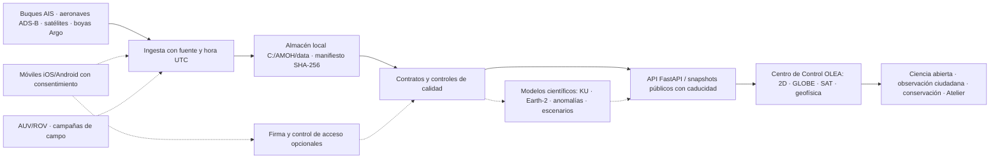

# OLEA: mapa de sistema y criterios de integración

OLEA conserva el nombre, las vistas y los datos existentes. Este diagrama separa los flujos operativos actuales de las integraciones que requieren infraestructura, permisos o validación científica. Ninguna capa se anuncia como «en vivo» por el mero hecho de tener un punto en pantalla.

Las flechas continuas son rutas existentes o que pueden validarse con el código actual. Las punteadas son propuestas: no prueban disponibilidad de sensores, modelos, licencias ni despliegue.

## Contrato mínimo de una capa

Cada entidad publicada debe declarar `source`, `source_url`, `observed_at_utc` o `issued_at_utc`, `fetched_at_utc`, `license`, `spatial_resolution`, `crs`, `uncertainty`, `quality_tier` y `method` (`direct_observation`, `interpolated_product`, `model_estimate`). El visor debe mostrar «sin datos recientes» cuando se supere la caducidad específica del proveedor.

## Restricciones de implementación

- GitHub Pages sirve archivos estáticos. Los sensores móviles, GEE autenticado, Pythia y cualquier canal WebSocket requieren un servicio público adicional con controles de abuso y protección de datos. El estado actual de Pages no constituye ese backend.
- El [MSPglobal Data Toolbox](https://toolbox.mspglobal2030.org/spatial-data-infrastructure/index.html) es una guía metodológica de infraestructura espacial marina. No equivale a un paquete de capas descargable ni otorga derechos sobre capas de terceros. `organize_amoh_data.py` cataloga la referencia sin inventar datos.
- La [API de Earth Engine](https://developers.google.com/earth-engine/guides/auth) requiere autenticación y un proyecto habilitado. El uso operativo/comercial requiere [evaluar su plan y condiciones](https://developers.google.com/earth-engine/guides/transition_to_commercial).
- La telemetría móvil se activa solo tras consentimiento específico por sensor. Las coordenadas, fotos, voz y señales de dispositivos pueden identificar personas; nunca se publican automáticamente bajo CC-BY. World ID y pruebas ZK son opciones de identidad, no sustitutos del consentimiento ni pruebas de validez científica.
- Los modelos de anomalías y escenarios deben publicar su conjunto de entrenamiento, partición espacial/temporal, calibración y límites. Una predicción no es una observación y no debe etiquetar una embarcación como infractora.
- El uso de NVG/IR debe distinguir claramente un filtro visual de una medición térmica. Una imagen RGB con paleta térmica no permite inferir temperatura ni detectar firmas infrarrojas.

## Ruta de despliegue

1. `main`: código fuente y CI; `pb124-pages`: salida estática. Evitar la edición manual de la rama de Pages cuando el pipeline de despliegue está activo.
2. Datos livianos con licencia verificada: snapshots públicos versionados y caducables. Datos crudos, privados o de terceros: almacenamiento controlado fuera de Git.
3. Backend público: API con `/health`, autenticación para contribuciones móviles, límites de tasa y registro de procedencia. El frontend debe usar URL configurada y mostrar estados de error verificables.
4. Observabilidad: métricas de frescura, cobertura y fallos de proveedor antes de añadir más indicadores en la cinta superior.

## Estado del PR histórico

El PR #1 apuntaba a `backend/app/ais_service.py`, ruta ausente de `main` tras la migración a `services/backend/`. La versión actual ya aplica `min_duration_hours`, incluye `start_utc`, `end_utc`, `duration_hours`, y marca señales como `UNREVIEWED`; tres pruebas de regresión pasan. Se cerró como incorporado sin fusionar código obsoleto.
