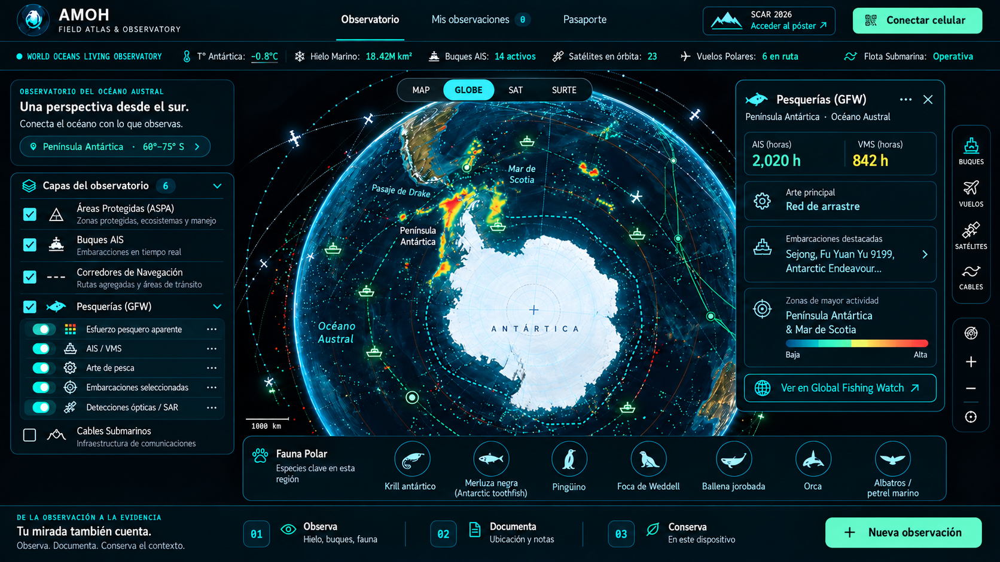

# Antarctic Maritime Observation Hub — Documentation

  <strong>WORLD OCEANS LIVING OBSERVATORY</strong> 
  <em>Field Atlas · Live Ocean Intelligence · Antarctic Expeditions · Scientific Passport</em>

  

  
  
  
  
  
  
  
  

  <a href="../Antarctic_Maritime_Hub_compressed.mp4"><strong>▶ Watch AMOH Demo</strong></a>
  &nbsp;&nbsp;·&nbsp;&nbsp;
  <a href="https://virtual.oxfordabstracts.com/event/75327/poster-gallery/grid?sort=titles&current=1820"><strong>SCAR 2026 Poster ↗</strong></a>

  <strong>Observe · Document · Understand · Preserve</strong>

---

## 🌊 What is AMOH?

**AMOH — Antarctic Maritime Observation Hub** is an experimental, map-first geospatial observatory for **Antarctica and the Southern Ocean**.

It is being developed as a **World Oceans Living Observatory** capable of connecting maritime activity, fisheries, satellite observations, Earth-system science, biodiversity, Antarctic expeditions, mobile field observations, scientific provenance and local artificial intelligence inside a unified spatial interface.

AMOH is not intended to be another static dashboard.

The goal is to create a **living scientific record of the Southern Ocean**, where observations can preserve their full context:

- where they happened;
- when they happened;
- which source produced them;
- how precise they are;
- what method generated them;
- whether they have been reviewed;
- what evidence supports them;
- and how they relate to other observations.

AMOH was initiated by **Juan Sebastian Huertas Olea** as an independent research and development project focused on Antarctic observation, open science, expedition continuity, scientific participation and the relationship between humanity and the ocean.

---

## 🇨🇴 Resumen en español

**AMOH — Antarctic Maritime Observation Hub** es un observatorio digital experimental para integrar, visualizar y documentar evidencia del **Océano Austral y la Antártida** desde una sola plataforma.

El proyecto busca conectar:

- actividad marítima;
- AIS;
- pesca;
- satélites;
- hielo marino;
- biodiversidad;
- ciencia del Sistema Tierra;
- observaciones de campo;
- expediciones;
- teléfonos y sensores;
- inteligencia artificial;
- cartografía científica;
- y procedencia de datos.

La plataforma está diseñada para operar normalmente conectada a Internet, pero sus funciones de **campo y expedición** pueden continuar en redes locales o sin conexión pública.

## Documentation index

- [Project status & scientific principles](principles.md) — Maturity of each capability, data states, and the Observation ≠ Causation principle.
- [Observatory: map, globe & filters](observatory.md) — World Oceans Living Observatory, Live Lens, Antarctic Globe, filters and semantic zoom.
- [Data sources & layers](data-sources.md) — AIS, Global Fishing Watch, fauna, biodiversity, krill, satellite, Earth sciences, Quantarctica, SURIE, cables, connectivity.
- [Field operations](field-operations.md) — DJI/aerial observation, Field Connect, QR pairing, Android Field Node.
- [Expeditions & science hub](expeditions.md) — Expeditions, NGS–Lindblad concept, Colombian Antarctic Programme, Science Hub, matchups.
- [Scientific passport & rewards](passport.md) — Passport, smart card, World ID, optional WLD rewards.
- [AI & forecasting](ai.md) — Pythia, AI analysis, Brier weighting, forecast rings, MiroFish.
- [Local data fabric & visualization](data-and-visualization.md) — Local storage model and scientific visualization rules.
- [Context: tourism, governance, legacy & culture](context.md) — Tourism, governance, radiological legacy, cameras, art, grants.
- [Performance & security](performance-security.md) — Performance philosophy and metrics, security model.
- [Architecture & operations](architecture.md) — Architecture, stack, deployment, ship LAN, cloud sync, testing.
- [Roadmap](roadmap.md) — Planned work by area.
- [Research & community](research-community.md) — SCAR 2026, research continuity, knowledge transfer, cooperation, sustainability.
- [About, independence & license](about.md)
- [Contributing](../CONTRIBUTING.md)
- [Monorepo guide](MONOREPO.md)
- [Audit & PR plan](AUDIT_ISSUES_AND_PR_PLAN.md)
